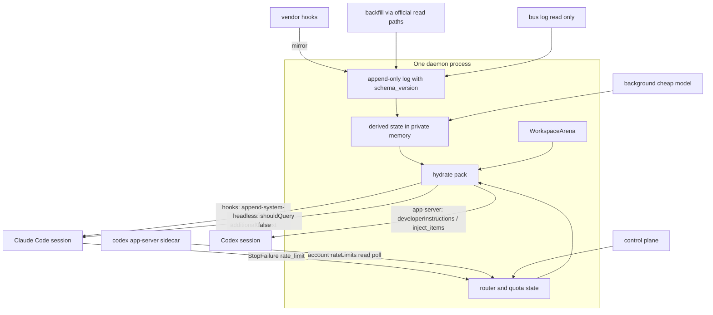

# Conbus — 벤더 대화 버스

제품명 **Conbus**(conversation bus). 바이너리 `conbus`, 대화 ID `bus_id`.

**이름 자산 현황(2026-08-30 조회).** crates.io `conbus` 미등록, npm `conbus` 미공개 — 둘 다 확보 가능. GitHub org `github.com/conbus`는 2015년 조직이 점유 중이라 **개인 계정 아래 `<user>/conbus`로 시작**하고 필요하면 나중에 대체 org로 옮긴다. 도메인은 `conbus.sh`·`conbus.io`·`conbus.ai`가 열려 있고 `conbus.com`은 2008년 등록, `.dev`/`.app`은 레지스트리 whois 제한으로 판정 불가. **도메인 확정은 MVP 직전으로 미루고 랜딩·웹 UI 작업과 함께 처리한다.**

D-20260829-001부터 004까지, 그리고 10 하네스 확장을 반영한 현재본이다.

## 목적지와 수단

**목적지(A): 버스가 루프를 소유하고 턴 단위로 라우팅한다.**
**0단계 수단(B): 벤더 TUI를 그대로 두고 훅으로 붙는다.**

이전 판은 정책 리스크 때문에 A를 No-Go로 찍었다. 그건 틀렸다. A가 이 계획이 실제로 말하는 제품이다. B는 hop·failover·코퍼스는 지키지만 **턴 단위 라우팅을 세션 단위 hop으로 격하시킨다.** 그 격하가 B의 비용이고, 이전 판은 그걸 “잃는 것”에 적지 않았다.

B를 0단계로 두는 이유는 정책이 아니라 **속도와 도그푸딩**이다. 렌더링을 만들지 않고, 행동 변화가 0이라 첫 주부터 매일 쓸 수 있다.

## route, not hop

두 벤더 모두 **모델 호출 없이 히스토리에 넣는 원시**가 있다.

- Codex `thread/inject_items` — raw Responses API items를 모델 가시 히스토리에 추가.
- Claude Agent SDK의 `shouldQuery: false` 사용자 메시지.

이 둘이면 **양쪽 세션을 동시에 살려 두고 동기화**할 수 있다. 턴은 한쪽으로 가고 결과는 다른 쪽에 주입된다. 그러면 hop이 아니라 **route**가 되고, 전환 시 콜드 스타트가 없다. “한 대화, 두 하네스”의 가장 강한 형태이고 A에서만 된다.

이전 판은 이 원시를 갭 메우기 도구로만 적었다. 0단계의 로그·팩 스키마는 처음부터 **dual-warm을 전제로** 잡는다.

### 결정: 0단계는 비대칭 dual-warm

**Codex 레그만 warm으로 둔다. Claude는 인터랙티브 그대로다.**

대칭 dual-warm에는 숨은 비용이 있다. Claude 쪽 원시인 `shouldQuery: false`는 Agent SDK 기능이고, 그건 곧 헤드리스 경로이며 **보류된 크레딧 분리 정책의 대상**이다. 아키텍처로 피해 둔 노출이 되돌아오고, `-p` 기본이 Manual이라 권한 프록시까지 딸려 온다. 0단계를 자르면서 이걸 넣는 것은 모순이다.

비대칭이면 셋이 동시에 해결된다.

- **정책 노출 0.** Claude는 인터랙티브 훅 경로에 남는다.
- **필요한 방향만 덮는다.** 사람들이 실제로 치는 한도는 Claude 쪽이다. 그래서 온기가 필요한 방향은 Claude→Codex 하나이고, 그 방향은 Codex 레그만 warm이면 콜드 스타트가 없다. 반대 방향(Codex→Claude)은 콜드 hop으로 둔다.
- **인프라 재활용.** 쿼터를 읽으려고 띄우는 `codex app-server` 사이드카가 warm 스레드를 유지할 연결과 같다. 프로브 1번과 겹친다.

비용은 매 턴 `inject_items`로 동기화하는 것뿐이고, 그건 모델 호출이 없어 Codex가 실제로 턴을 돌릴 때까지 거의 무료다.

**대칭 dual-warm은 1단계다.** 그때 Claude 레그를 headless로 올리고 권한 프록시를 붙이며, 정책 상태에 따라 모드를 고른다.

**Codex 쪽에는 경계가 있다.** Codex에는 현재 스레드의 보존된 롤백 소스를 지우는 원시가 없다. 그래서 롤백한 프롬프트가 재시작 후 되살아나는 사고가 실제로 보고됐다. 결론은 셋이다.

- A(헤드리스)에서 `thread/inject_items`는 **우리가 app-server로 연 스레드에만** 쓴다. 사용자가 직접 연 라이브 Codex TUI 스레드에 주입하지 않는다.
- B(0단계)에서 Codex로 hop할 때는 **새 스레드 + developer item**으로 간다. 검증된 경로다.
- 따라서 dual-warm의 Codex 레그는 **처음부터 우리 소유 스레드**여야 한다. 사용자가 열어 둔 세션을 나중에 warm 쌍에 편입할 수 없다. “Codex 레그는 app-server 기본”이 A에서 필수가 되는 이유가 이것이다.

## 정책은 아키텍처가 흡수한다

확인된 사실이다. Anthropic은 2026-05-13에 Agent SDK와 `claude -p`를 구독 한도에서 떼어 별도 월 크레딧(Pro $20, Max 5x $100, Max 20x $200, API 요율)으로 옮긴다고 공지하고 **“Interactive Claude Code in the terminal or IDE”는 명시적으로 제외**했다. 06-15에 “pausing the changes … nothing has changed … working to update the plan”으로 보류했다. 철회가 아니다.

그러나 궤적을 보면 방향은 **금지가 아니라 계량**이다. 01-09 하네스 스푸핑 차단 → 02-18 OAuth 문구 명확화 → 04-04 OpenClaw 차단 → 05-13 크레딧안 → 06-15 보류. 계량은 비용이지 사망이 아니고, **보류는 한 달 만에 왔다.** 생태계가 밀었고 벤더가 물러섰다.

그리고 지금은 두 벤더가 하네스 개발자를 두고 경쟁하는 국면이다. OpenAI는 하네스 친화를 경쟁 무기로 쓰고 Codex 리드는 서드파티 하네스의 ChatGPT 로그인 사용을 공개적으로 문제없다고 했다. **중립 라우터를 깨는 쪽이 정치적 비용을 진다. OSS는 신뢰 장치이자 정치적 보호막이다.**

그래서 정책이 아키텍처를 고르게 하지 않는다. **Attach가 처음부터 모드 둘을 갖는다.**

- `interactive+hooks` — 벤더 TUI가 살아 있고 훅으로 미러·주입. 크레딧 분리와 `--bare` 전환에 무관.
- `headless` — `-p`, `app-server`. 배경 작업과 A 경로.

Claude 레그는 정책 상태에 따라 모드를 고른다. **Codex 레그가 app-server 기본이라는 것은 A 문장이지 0단계 문장이 아니다.** 0단계 B에서 Codex는 인터랙티브 TUI + 훅인데, Codex 훅에는 `StopFailure` 상당이 없고 `account/rateLimits/updated`는 app-server 전용이다. 그대로 두면 0단계는 Claude→Codex **단방향** failover만 된다.

해법은 rate limit이 **계정 단위**라는 점이다. 사이드카로 `codex app-server` 프로세스를 하나 띄워 `account/rateLimits/read`를 폴링하면, 어느 프로세스가 소모했든 읽힌다. **이것이 프로브 1번이다.** 확인되면 0단계에서 양방향이 되고, 안 되면 문서와 성공 조건을 단방향으로 좁힌다.

## 필요조건

**버스는 대화 상태와 `bus_id`와 hop을 소유한다. 0단계에서 창은 벤더 TUI다.**

전역 훅이므로 **모든 벤더 세션이 기본으로 버스 위에 있다.** “버스 없이 켜면 버스 밖”이라는 사용 규칙 문제가 사라진다.

## Paseo의 `fork_context`와 무엇이 다른가

Paseo는 이미 이력을 첨부해 새 에이전트를 시딩한다(`agent.fork_context`, `/paseo-handoff`). 차이는 속도가 아니다. 속도로 설명하려 했던 이전 판이 틀렸다.

- 같은 `bus_id`의 **연속 로그**. 복사가 아니라 하나의 대화다.
- **매 턴 증분 파생 상태.** 시딩 시점 한 번이 아니다.
- **자동 트리거.** 쿼터·정책·장애가 라우팅을 발동한다.
- **벤더 세션 파일 포맷 비의존.** 공식 읽기 경로만 쓴다.

## 파는 것

### 개인

**“모델이 아니라 하네스째로 갈아끼운다.”** 한 대화에서 모델을 바꾸는 건 이미 무료다(OpenCode는 메시지마다 모델을 바꾼다). 우리 웨지는 Claude Code와 Codex라는 **하네스 자체**(툴셋·시스템 프롬프트·서브에이전트·권한 모델·구독 쿼터)를 한 대화 안에서 교체하는 것이다.

- **작업별 라우팅이 1차 가치다.** 쿼터가 멀쩡할 때도 hop할 이유가 있어야 한다.
- **failover는 2차다.** 한도에 걸려도 대화가 죽지 않는다.
- **재설명 제로.**
- **설치 직후부터 두껍다.** 디스크에 있는 지난 히스토리를 첫날 백필한다.

**포지셔닝은 절약이 아니라 보험이다.** 파는 문장: *“이 대화는 벤더 한도·정책·장애에 N번 살아남았다. 대화 손실 0.”* 지난 8개월 정책 이벤트마다 화난 사용자가 쌓였고 주기는 대략 6주다.

**대비를 두 단어로 박는다. 프로젝트가 아니라 대화, 손으로가 아니라 자동으로.** 인접 제품들은 프로젝트 지식을 넘기고 사람이 전환한다. 우리는 대화를 넘기고 라우터가 전환한다. 이 차이는 데모 한 번으로 보인다. 경쟁사 이름은 쓰지 않는다.

### 팀

**“에이전트가 알아낸 것이 사람과 도구가 바뀌어도 남는다.”** 공유 아레나, 중복 소각 방지, 온보딩, 감사, 비용 귀속. 엔터프라이즈는 지금 설계하지 않는다.

### 벤더 정렬

BM 절에 아예 없던 축이다. 버스는 Claude 한도에 걸린 사용자를 Codex로 보내는 장치다. 즉 한쪽 벤더에게는 유입 경로다.

- OpenAI의 OSS 하네스 프로그램에 먼저 접촉하고 가장 좋은 hop-to-Codex 경험을 만든다.
- Paseo #3778 스레드에 **연속성 레이어**로 등장한다. 그 PR의 저자와 사용자가 첫 사용자다.
- ACP에 크로스 에이전트 세션 이관 RFD를 우리가 쓴다.

## 무료와 유료의 경계

로컬 단일 사용자는 전부 무료·오픈소스. 과금은 머신과 사람 경계를 넘을 때만.

- **무료:** 데몬, 로그, 훅 사이드카, PTY 래퍼, `bus log`, 컨트롤 플레인, 라우팅과 failover, 백필, 로컬 아레나, 생존 카운터. **hop 횟수와 벤더 수는 잠그지 않는다.**
- **Pro(머신 경계):** E2EE 컨텍스트 동기화, 장기 아카이브와 의미 검색, 히스토리 분석. 폰/원격은 Pro 항목이 아니다. Paseo에 위임한다.
- **Team(사람 경계):** 공유 아레나, 멤버 간 recall, 감사, 좌석, 비용 귀속.

가격 가설: 개인 월 10~20달러, 팀 좌석당 15~25달러.

## 정책 가드레일

- **벤더 인증 토큰은 읽지도 저장하지도 중개하지도 않는다.** 로그인은 무수정 벤더 바이너리의 자체 플로우로만. 이건 방어가 아니라 관측된 사실이다. **토큰을 만진 쪽만 차단당했다**(OpenCode는 법적 요청으로 Claude 인증을 제거했고, 무수정 바이너리를 자식으로 띄운 쪽은 하나도 당하지 않았다).
- **바이너리를 수정하지 않고 인증 방식을 제거하지 않는다.**
- **크레덴셜과 쿼터를 사람 사이에 풀링하지 않는다.** Team 공유 라우팅 정책이 여기로 흐르면 위반이다. 다만 **라우팅 정책 자체는 설정이지 서비스 대여가 아니다.** 이전 판이 덧붙인 서비스 재판매 경계는 철회한다. 각자 자기 로그인을 쓰는 한 경계는 크레덴셜뿐이다.
- **크로스 벤더 전송은 기본 on, 워크스페이스별 off.** 자기 대화를 다른 도구에 넘기는 것은 정상 사용이다. 벤더 약관이 막는 것은 경쟁 모델 학습이지 자기 작업의 연속성이 아니다. 이전 판의 “동의 사항” 과잉 방어를 걷는다. (법률 자문 아님.)
- **`-p`는 배경 작업과 A 경로에만.** `--bare`가 `-p` 기본값이 될 예정이므로 플래그를 명시 고정하고 프로브가 전환을 감지한다.
- **벤더 상표를 제품·기능명에 쓰지 않는다.** Paseo 상표도 같다.
- **정책 이벤트 대응 시간을 운영 지표로 둔다.**

## 아키텍처

**첫 커밋은 레코더다.** 훅 → 로그 → 백필. hop이 되기 전에 코퍼스 시계를 돌린다. 해자가 시간이라면 시계를 먼저 켜는 것이 순서다. **1주 목표는 기록만이고 주입은 포함하지 않는다.**

**mmap 링은 0단계 밖이다.** 파일 기반 mmap 링과 봉투 암호화와 capability 토큰은 서로를 무효화한다. 링 파일이 0600 평문이면 같은 uid 프로세스가 그냥 읽는다. 링은 **데몬 사적 메모리**(익명 매핑, mlock, 코어덤프 차단)이고 클라이언트는 소켓으로만 읽는다. “hop 경로 디스크 읽기 0”은 지표에서 삭제한다.

**로그는 첫날부터 `schema_version`과 벤더·버전 스탬프를 갖는다.** 그래야 나중 동기화가 머지가 아니라 로그 배송 문제가 된다.

## 훅 사이드카와 벤더별 채널

Claude Code 훅은 세션당 `SessionStart`/`SessionEnd`, 턴당 `UserPromptSubmit`/`Stop`/`StopFailure`, 툴콜마다 `PreToolUse`/`PostToolUse`가 발화하고 `additionalContext`로 주입한다. `StopFailure` 매처에 `rate_limit`, `oauth_org_not_allowed`, `billing_error`, `authentication_failed`가 있어 쿼터와 정책 오류를 같은 채널로 잡는다.

- **Claude Code.** 미러는 `UserPromptSubmit`·`PostToolUse`·`Stop`·`StopFailure`(`command`/`http` 훅). 세션 시작 주입은 `--append-system-prompt-file`과 `SessionStart additionalContext`. 매 턴 주입은 `UserPromptSubmit additionalContext`. ID는 `--session-id`로 `bus_id`를 세션 UUID로 그대로 쓴다. 헤드리스 모드에서는 `rate_limit_event`와 `shouldQuery: false` 주입.
- **Codex.** 훅(옵트인·trust 게이트) 또는 app-server(stdio JSON-RPC) 알림. 주입은 `developerInstructions`와 `thread/inject_items`. `SessionStart additionalContext`는 기본 약 2,500 토큰 상한(`additionalContextLimit`). 쿼터는 `account/rateLimits/updated`와 `codexErrorInfo=UsageLimitExceeded`.
- **Cursor.** 1단계. 진입은 **훅 우선, ACP 병행**이다. 서드파티 훅 옵션을 켜면 `.claude/settings.json`을 읽으므로 등록만으로 미러·주입이 되고, 승인이 필요한 작업은 ACP로 간다. `-p` 경로는 쓰지 않는다 — 승인 채널이 없고 실패가 stderr뿐이다. 0단계에서 빠지는 이유는 훅이 없어서가 아니라 **구조화된 쿼터 신호가 없어 자동 라우팅을 증명할 수 없기 때문**이다.
- **OpenCode.** ACP 네이티브이고 TUI가 서버의 클라이언트다.

## 하네스 커버리지

10개를 평평한 목록으로 두면 안 된다. 성격이 세 가지로 갈리고, 우리가 할 수 있는 일도 다르다.

### 결정적 레버리지: Claude 훅 포맷이 사실상 표준이 됐다

조사에서 확인한 것이 이번 확장의 전제를 바꾼다. **Claude Code `settings.json` 훅 포맷을 읽는 하네스가 넷이다.**

- **Copilot CLI** — 훅을 policy → user(`~/.copilot/hooks/`) → project(`.github/hooks/*.json`) → plugin 순으로 합치고, 그 목록에 `.claude/settings.json`·`.claude/settings.local.json`이 포함된다. 이벤트는 `sessionStart`(`additionalContext` 주입 가능), `userPromptSubmitted`, `preToolUse`.
- **Devin CLI** — `.devin/hooks.v1.json`이 권장 경로지만 `read_config_from.claude`가 **기본 활성**이라 `.claude/settings.json`, `~/.claude.json`, `~/.claude/settings.json`을 자동으로 읽는다.
- **Cursor** — 서드파티 훅 옵션을 켜면 같은 파일을 읽는다.
- **Codex** — Claude `settings.json` 훅을 읽어 병합한다(자체 훅은 옵트인·trust 게이트).

즉 **훅 바이너리 하나 + 등록 N개**로 다섯 하네스를 덮는다. 이것이 어댑터 트레드밀 리스크에 대한 실질적 답이고, 1인이 12 하네스를 덮은 인접 사례와 같은 구조다. 바이너리는 자기를 부른 하네스를 env·argv로 식별해 정규 이벤트로 바꾼다.

### 계층

- **1계층 — route (dual-warm).** 조건이 둘이다. 모델 호출 없는 히스토리 주입, 그리고 구조화된 쿼터 신호. 충족하는 것은 **Claude Code**(`shouldQuery: false`)와 **Codex**(`thread/inject_items`, `account/rateLimits`)뿐이다. 0단계 범위는 여기서 안 늘린다.
- **2계층 — hop + 미러 + 주입 (세션 단위).** Claude 훅 포맷을 읽는 집합: **Cursor, Copilot CLI, Devin CLI**. 주입은 `sessionStart additionalContext`, 미러는 프롬프트·툴·정지 이벤트. 대부분 **쿼터 신호가 없다.** 그래서 자동 failover가 아니라 작업별 라우팅과 수동 hop만 제공한다.
- **3계층 — 자체 이벤트 표면.** **OpenCode**가 가장 강하다(서버 SSE + ACP 네이티브 + 인프로세스 플러그인, TUI가 서버의 클라이언트라 B 구조가 원래 설계). **Agy**(Google Antigravity CLI, Gemini CLI를 2026-06-18에 대체한 Go 단일 바이너리)는 Gemini CLI에서 훅·스킬·서브에이전트·플러그인을 승계했고 설정은 `~/.gemini/`, 지침은 `AGENTS.md`, 플러그인은 Claude Code에서 가져올 수 있다. **Grok**은 훅 파일 관례(`~/.grok/hooks/*.json`)가 실측으로 확인됐으나 문서가 없어 프로브 대상이다.
- **4계층 — 오케스트레이터. 어댑터를 쓰면 안 된다.** **Paseo**와 **Orca**는 하네스가 아니라 하네스를 **띄우는** 쪽이다. 이걸 Attach로 구현하는 것은 범주 오류다. 통합 방향이 반대다. Paseo는 `paseo run`이 우리 `bus` 명령을 실행하고, Orca는 관리 터미널 안에서 우리 래퍼를 띄우거나 `orca terminal send`/`read`/`wait`와 핸드오프를 우리가 호출한다. 즉 **그들이 우리를 실행한다.**
- **5계층 — 원격.** Devin 클라우드 세션 API, Copilot 클라우드 에이전트, Cursor 클라우드 에이전트. 로컬 훅이 없고 API 폴링·웹훅으로만 미러링된다. 별도 계층으로 두고 2단계 이후에 본다.

### 능력 선언이 필수다

능력 차이가 크므로 `Attach`는 **capability descriptor**를 노출해야 한다. `mirror`, `inject_session_start`, `inject_per_turn`, `history_inject_no_model`, `quota_signal`, `permission_proxy`, `steer`. 라우터는 없는 능력을 가정하지 않고 열화한다. **쿼터 신호가 없는 레그에 자동 failover를 약속하지 않는다.** 컨트롤 플레인이 레그별로 무엇이 가능한지 그대로 보여준다.

**여유(headroom)도 능력이다.** 신호가 있어도 받아줄 여유가 없으면 라우팅 목적지가 못 된다. Agy 무료 한도는 하루 약 20요청이라 소스로는 쓸 수 있어도 **오버플로 목적지로는 못 쓴다.** descriptor에 `usable_as_target`을 두고 한도 규모를 반영한다.

**설치와 진단이 1급 기능이다.** 하네스 다섯 곳에 훅을 등록하고 그중 일부는 옵트인·trust 게이트가 걸려 있다. `bus install`(감지·등록·복구)과 `bus doctor`(어느 훅이 실제로 발화하는지, 주입이 inline인지, 쿼터 신호가 오는지)가 없으면 사용자는 조용히 반쯤 연결된 상태로 남는다. 인접 제품 둘 다 `install`을 1급으로 둔 이유가 이것이다.

**Windows를 처음부터 고려한다.** Copilot 훅은 `bash`와 `powershell` 키를 **둘 다** 요구하고 OS에 따라 고른다. 우리 훅 바이너리는 두 호출 형태를 함께 등록해야 한다. 그리고 메모리 경로가 홈 디렉터리 기준이면 Windows와 WSL2 사이를 넘지 못한다는 실측 보고가 있으니, 경로 기준을 `bus install` 시점에 고정하고 `doctor`가 불일치를 잡는다.

### 순서

- **0단계:** Claude Code ↔ Codex. 변경 없음.
- **1단계:** 훅 바이너리 하나로 Cursor·Copilot·Devin CLI를 등록만으로 편입. 이어서 OpenCode(ACP/서버), Agy(훅·플러그인), Grok(프로브).
- **2단계:** Paseo·Orca 오케스트레이터 통합, 원격 계층.

### 스펙 공개와 연결된다

훅 계약을 **Claude settings 호환 포맷으로 공개**하면, 그 포맷을 읽는 하네스가 늘어날 때마다 우리 커버리지가 공짜로 늘어난다. `publish-rfd`의 첫 산출물을 ACP RFD가 아니라 이 훅 계약으로 두는 편이 회수가 빠르다.

### 시장 배경 두 가지

라우터의 필요를 강화하는 사실이 있다. Google은 2026-06-18에 Gemini CLI를 종료하고 Agy로 대체하며 무료 한도를 하루 약 1,000요청에서 약 20으로 줄였다. **쿼터 붕괴는 예외가 아니라 정상이다.** 그리고 xAI·SpaceX가 Cursor 인수를 발표해 Q3 종결 예정이라, Cursor와 Grok이 한 벤더 레그로 합쳐질 수 있다. 레그 목록은 벤더 지형에 따라 변하므로 어댑터는 벤더가 아니라 **능력**으로 묶는다.

## 훅 실측 제약 (Claude 경로)

**10,000자 상한은 문서에 있다.** 훅 문서가 “Hook output strings, including `additionalContext`, `systemMessage`, and plain stdout, are capped at 10,000 characters”라고 쓰고, 초과 시 세션 디렉터리 파일에 전문을 쓰고 경로와 프리뷰를 넘긴다고 한 번 더 적는다. 가설이 아니라 확인된 제약이다. 그래서 큰 팩은 spawn 시 시스템 프롬프트 파일로, 턴 델타만 `additionalContext`로 보낸다.

**재개는 오히려 유리하다.** `--resume`에서 낡는 것은 `PostToolUse`·`UserPromptSubmit` 같은 중간 이벤트의 **과거 턴 텍스트**다(훅을 다시 돌리지 않고 저장본을 재생하므로 시각·SHA가 낡는다). 반면 `SessionStart` 매처는 `startup`·`resume`·`clear`·`compact`·`fork`를 갖고, 재개 시 `source`가 `resume`/`fork`로 다시 돈다. 즉 **재개마다 새 팩을 다시 넣을 수 있다.** 팩에 생성 시각은 계속 박고, `compact` 매처는 컴팩션 직후 재주입 훅으로 쓴다.

**우리가 띄운 배경 세션은 미러링에서 제외한다.** 전역 훅이면 요약용 배경 `-p` 세션도 훅을 발화시켜 로그에 자기 잡음이 섞인다. spawn 시 env 마커를 넣고 훅이 그 마커를 보면 즉시 종료한다.

**`bus_id`는 SessionStart에서 민트하지 않는다.** Claude Code는 같은 프로젝트에 수백 ms 안에 `SessionStart`를 여러 번 쏘고 그중 일부는 트랜스크립트가 생기지 않는 유령이다(anthropics/claude-code#78455). SessionStart에서 민트하면 유령 ID가 쌓이고, 최악에는 진짜 세션이 유령의 별칭을 못 받는다. 그래서 **SessionStart는 후보 등록만 하고, 첫 `UserPromptSubmit`에서 민트·바인딩**한다.

**주입 채널은 훅 stdout/`additionalContext`와 시스템 프롬프트 플래그뿐이다.** `initialUserMessage`는 실기에서 헤드리스 전용으로 보고됐고, 트랜스크립트 JSONL에 합성 턴을 덧붙이는 방식은 반증됐다. 인터랙티브 경로에서 다른 문을 찾지 않는다.

**10k 상한의 진짜 위험은 조용한 실패다.** 초과하면 예외가 아니라 열화가 일어난다. 모델은 파일 경로와 앞부분 프리뷰만 본다. 헤더와 앵커가 우연히 프리뷰에 들어가면 몇 주 동안 “되는 것처럼” 보인다는 실측 보고가 있다. 그래서 프로브에 **주입이 inline인지 단언**을 넣는다. 트랜스크립트 attachment에 `<persisted-output>`이 나타나면 실패로 처리한다. 훅을 여러 개로 쪼개 상한을 우회하는 방법은 attachment 순서가 비결정이라 쓰지 않는다.

**기록에는 플러시 배리어가 필요하다.** 트랜스크립트는 비동기로 쓰인다. `Stop`에서 마지막 어시스턴트 메시지가 파일에 나타날 때까지 짧게(2초 이내) 기다려야 턴이 유실되지 않는다.

**알려진 예외 하나.** Claude Code Desktop의 `/clear`는 `source`를 보내지 않아 자동 계승이 안 된다(#76704). 문서화하고 우회하지 않는다.

## 팩 스펙

- 섹션: 목표, 결정, `turn_state`, 미완 작업, 접촉 파일과 sha, 링크된 아레나 꼬리, `code_freshness`.
- **요약과 원문을 구분 표시한다.** 압축 손실이 가장 조용한 실패다.
- **데이터 경계 마킹.** 버스는 A 벤더의 툴 출력을 B에 주입한다. 크로스 벤더 인젝션 전파 경로이고 `inject_items`가 가장 강력하며 가장 위험하다. 주입 블록은 사실 서술로 쓴다.
- 채널별 예산: spawn 파일은 벤더 컨텍스트 예산까지, 턴 델타는 10,000자 **상한이 아니라 목표는 수백 자**, Codex `SessionStart`는 약 2,500 토큰.

**매 턴 주입은 공짜가 아니다.** 이전 판의 “보강 비용이 0에 가까우면 매 턴 주입한다”는 **생산** 비용 얘기였다. 소비 비용은 따로 청구된다. 인접 제품의 자체 벤치마크에서 툴 스키마 + 훅 + 매 프롬프트 검색의 고정 오버헤드가 작은 작업에 입력 토큰 +83,520, 비용 +$0.13, 시간 +24초였고 “결코 상각되지 않는다”고 기록됐다. 우리가 아레나 꼬리를 매 턴 넣으면 같은 청구서가 온다. 그래서 셋을 건다.

- **문자 예산.** 턴 델타는 수백 자 단위로 묶는다.
- **관련성 게이트.** 짧은 프롬프트는 스킵, 앵커 파일이 걸릴 때만 주입.
- **캐시 친화 확인.** `additionalContext`는 시스템 리마인더로 대화에 삽입되므로 프리픽스 캐시를 깨지 않는지 프로브로 확인한다.

그리고 `survival-meter`에 **턴당 주입 토큰**을 재설명 절감과 나란히 놓는다. 주입이 절감보다 크면 아레나 꼬리를 끈다.

## 턴 원자성과 hop-back

쿼터 소진은 턴 중간 툴 루프에서 온다. 로그에 `turn_state {complete, interrupted_quota, interrupted_user}`를 둔다. 팩에는 “이전 하네스가 X까지 실행, Y 미완”을 넣는다.

**hop-back.** Claude → Codex → Claude로 돌아오면 Claude 네이티브 세션에 Codex 턴이 없다. 복귀 시 `SessionStart`/`UserPromptSubmit additionalContext`로 부재중 요약을 주입한다. dual-warm이 켜지면 이 문제 자체가 줄어든다.

## 라우터

소진 후 failover만으로는 부족하다. 소진 **전에** 옮긴다.

- Claude: `rate_limit_event`의 `allowed_warning`/`rejected`, `utilization`, `resetsAt`, five_hour/seven_day.
- Codex: `account/rateLimits/updated`의 `usedPercent`, `resetsAt`.
- 판단 예: 5시간 창 80%에 리셋 2시간 남음 → 다음 턴부터 Codex.
- 리셋 대기도 상태로 둔다.

## 요약

추출식만으로는 목표와 결정이 나오지 않는다. 그런데 쿼터가 소진된 시점에는 나가는 모델에게 요약을 시킬 수 없다. 그래서 롤링 요약을 **사전에 백그라운드에서** N턴마다 비동기로 갱신한다. hop 경로의 모델 호출은 0이다.

**단, 요약이 보호하려는 레그를 태우면 안 된다.** 오늘 규칙에서 `claude -p`는 구독 한도에서 나간다(06-15 헬프센터가 명시). `claude -p --model haiku`로 요약하면 우리가 지키려던 Claude 한도를 우리가 갉아먹는다. 그래서 요약 백엔드는 **라우터가 여유 있는 레그로 보내거나, 로컬 모델, 또는 별도 API 키**로 보낸다. **보호 중인 레그에는 절대 보내지 않는다.** 이건 규칙이지 최적화가 아니다.

**기본값은 상대 벤더의 저효력 모델이다.** 같은 패턴이 이미 실측으로 검증됐다. Claude를 1급으로 쓰는 구성에서 요약을 Codex 저효력 모델로 보내고 Claude Haiku를 폴백으로 두는 방식이 82회 평가에서 날조 0건, 핵심 recall 91~93%를 기록했다. 우리 기본값을 여기에 맞춘다. 실패 시 폴백은 상대 레그 → 로컬 → 원문 복사 순이다.

## 어댑터와 프로브

`Attach`는 양방향이고 모드 둘을 갖는다.

- 0단계 구현: `mirror`, `hydrate`(채널 종류 포함), `usage_probe`, `stop`.
- 1단계: `permission`(A 경로 필수 — `-p` 기본이 Manual이라 핸들러 없이는 프롬프트 필요 툴이 전부 거부된다), `ask_user`, `steer`/`interrupt`.

**프로브 범위가 절반으로 줄었다.** 우리가 프로브로 사려던 “문서에 없는 것” 상당수가 인접 레코더의 4개월치 실측 노트에 이미 있다. 아이디어와 사실은 저작물이 아니므로 그대로 픽스처 목표로 옮긴다. 10k 상한과 조용한 열화, 유령 SessionStart, 트랜스크립트 비동기 기록과 플러시 대기, `initialUserMessage` 헤드리스 한정, Desktop `/clear` 누락, Codex 롤백 소스 재출현, Codex 훅은 절대 경로 등록 필요, `Stop` 훅 비동기 필요, 트랜스크립트 모델 접미 누락, 프로젝트 경로 키 바통이 다른 호스트에 새는 문제.

**프로브 하네스**가 실제 트래픽을 골든 픽스처로 기록하고, 그 픽스처가 적합성 테스트가 된다. 픽스처에 정책 오류도 포함한다(`oauth_org_not_allowed`, `billing_error`, `credits_required`, `--bare` 전환). 공개 CI에서 구독 CLI를 돌릴 수 없으므로 CI는 픽스처 재생만, 실트래픽은 로컬에서. 쿼터 픽스처는 실제 한도에 닿아야 얻으므로 도그푸딩 첫 소진을 기록 기회로 쓴다.

**라이브 경로에서는 벤더 세션 파일을 파싱하지 않는다.** Claude 문서가 트랜스크립트 포맷은 내부 구현이고 릴리스마다 바뀐다고 명시하고, Codex 롤아웃은 `.jsonl.zst`로 압축될 수 있다. 미러·갭 메우기·라우팅은 공식 경로만 쓴다. 백필은 예외이고 조건이 붙는다(아래).

## 백필

**설치 첫날 지난 히스토리를 정규화 코퍼스에 넣는다.** Codex `thread/list`·`thread/read`(Rust 바이너리)와 OpenCode `export`는 공식 경로로 문제없다.

**Claude만 걸린다.** 공식 읽기 경로인 `listSessions`/`getSessionMessages`/`SessionStore`가 JS·Python SDK라서, Rust 데몬이 쓰려면 Node 헬퍼가 새 의존성으로 붙는다. 그래서 백필에만 예외를 둔다.

- 백필은 **픽스처로 보호된 일회성 파서**를 허용한다. 실패하면 코퍼스가 얇아질 뿐 **대화는 죽지 않는다.** 라이브 경로와 실패 비용이 다르므로 규칙도 달라야 한다.
- 파서는 읽은 벤더 버전을 스탬프하고, 모르는 스키마를 만나면 조용히 건너뛴다. 부분 성공을 정상으로 취급한다.
- Node가 이미 있는 환경에서는 공식 SDK 경로를 우선한다. 파서가 자주 깨지면 Node 헬퍼를 옵션 의존성으로 승격한다.

낮은 우선순위 소스 둘을 더 둔다. 사용자가 이미 쓰던 도구가 남긴 구조화 기록이 있으면 코퍼스 시계를 더 앞당길 수 있다. 인접 레코더의 로컬 SQLite(대화 원문과 툴 I/O가 계층으로 분리돼 있다)와 인접 fact 제품의 export가 후보다. 필수가 아니라 있으면 좋은 항목이다.

Codex `/import`가 이미 Claude Code 세션을 가져온다. 이전 판은 그걸 위협으로만 적고 같은 무기를 들지 않았다. 백필하지 않으면 코퍼스 시계가 0에서 시작하고, 하면 첫날부터 수개월이다.

## Paseo

**수요 신호다.** 15.3k★, 164 기여자, 월 약 580 커밋, 1인 유지자·자체 자금. 세션 중 프로바이더 변경 불가 버그(#2780)에 대해 PR #3778 “provider account profiles and seamless continuation”(08-24)이 열려 있고 리뷰가 붙지 않았다. 커뮤니티가 직접 연속성을 만들고 있다는 뜻이고, **첫 사용자가 거기 있다.** 대응은 경쟁이 아니라 Paseo가 부를 수 있는 연속성 레이어가 되는 것이다. 외부 세션 임포트와 generic ACP 어댑터가 이미 있어 접점이 있다.

**코드는 쓰지 않는다.** 라이선스는 확정됐다. PR #3944가 2026-08-27 머지되어 Apache-2.0이고 이슈 #2982는 같은 날 종결됐다(02월 이전은 MIT). 즉 잔여 분쟁 여지는 사실로도 닫혔다. 그래도 옮기지 않는다. 우리는 이미 저장소를 읽어 clean room 방어를 쓸 수 없고, 어차피 그들의 탭 단위 TS 모델이 우리 구조와 다르다. 참조는 **관찰 가능한 동작**까지이고 대부분 Paseo가 아니라 벤더의 사실이다. 모듈 경계·분해·네이밍은 따라가지 않는다. 문서 문장도 복사하지 않는다.

**우리 라이선스는 사실상 닫혔다.** 카피레프트 방어는 “Paseo·Zed·JetBrains 안으로의 배포”라는 해자 후보와 채택 원칙을 둘 다 죽인다. Apache-2.0 권고. 흡수 가능성은 받아들이는 비용이다.

## 워크스페이스 아레나

첫 시험장은 팀이 아니라 **한 대의 맥에 있는 여러 워크스페이스**다. 같은 검증 파이프라인을 두 워크스페이스가 독립적으로 다시 만든 일이 이미 있었고, 그게 중복 소각의 단일 사용자 버전이다.

0단계에서 정하는 계약은 셋으로 나뉜다.

**스키마는 기준선을 차용한다.** 인접 fact 제품이 이미 도달한 지점을 출발선으로 쓴다. 타입 분류, **작성 시 라이프사이클 필수 선택**(작업 종료 시 만료 / 날짜 만료 / 기한 / 영구), `supersedes`에 **evidence 필수**(옛 상태가 실제로 끝났음을 증명하는 원문 한 줄), `contradicts`는 하나를 고르지 않고 **둘 다 보존해 충돌 자체를 에이전트에게 보여주기**, 신선도와 검증의 **두 시계 분리**, 앵커 파일·심볼, 출처(어느 하네스·모델·턴), 버전 이력. 아이디어는 저작물이 아니고, 여기서 다시 발명할 이유가 없다.

**메커니즘은 다르게 간다. 로그에서 도출한다.** 그들이 스스로 인정한 “어려운 절반”이 이것이다. *“기록에 좋은 것을 넣는 무언가가 있어야 하고, 에이전트가 기록할 가치를 아는 순간은 그것이 다른 일로 바쁜 순간이다.”* 그래서 그 제품은 바쁜 에이전트의 선의에 의존하고, 그래프가 시끄러워졌다고 적었다. 우리에겐 그들에게 없는 것이 있다. **전체 기록.** 그래서 fact를 작업 중인 에이전트가 쓰게 하지 않고, 툴 이벤트에서만 뽑지도 않고, **백그라운드에서 로그로부터 도출**한다. 롤링 요약과 같은 싼 모델이 N턴마다 후보 fact를 뽑고, 출처 턴을 달고, 사용자가 확인하거나 워크스페이스 정책으로 자동 수용한다. 그들의 일회성 백필을 **연속으로** 하는 것이다. 이건 레코더가 있어야만 가능하다.

**싱크는 어댑터로 둔다.** 로컬 스키마를 정본으로 두고 export 어댑터 인터페이스를 만든다. 첫 타깃 후보는 그 제품의 hosted MCP이고, 1단계 선택 사항이다. 사용자 0의 프로프라이어터리 베타에 의존하지 않되 길은 열어 둔다.

나머지 계약: 동의(사적 대화가 링크된 워크스페이스로 누출). 구현은 1단계, 출하는 Team 단계다.

## 리소스 예산

핫 메모리 요구는 히스토리 길이가 아니라 **모델 컨텍스트 창**에 상한이 걸린다. 팩은 벤더 예산을 넘을 수 없고, 턴 델타는 하드 상한이 10,000자이지만 목표는 수백 자다(팩 스펙 참조).

- 이벤트 인라인 상한 16 KB. 초과분은 보관 수준에 따라 버리거나 아카이브로.
- 유휴 대화는 파생 상태만 남기고 축출.
- 요약은 백그라운드 싼 모델. hop 경로 로컬 CPU와 모델 호출 0.
- 아카이브는 zstd + 보존 기간. 기본 보관이 “대화만”이라 무거운 하루도 수 MB.
- 목표: 데몬 RSS 50 MB 이하, 유휴 CPU 0% 근접.

## 위협 모델

- **T1 오프라인 디스크.** 암호화가 이기는 유일한 영역. 2단계.
- **T2 같은 사용자 권한 로컬 프로세스.** 암호화로 못 막는다. 소켓 인가와 최소 보관.
- **T3 클라우드 동기화.** 키가 기기를 떠나지 않는 E2EE.
- **T4 프롬프트 인젝션.** 인가와 데이터 경계 마킹. 크로스 벤더 전파 포함.

**벤더 로그인을 키로 쓸 수 없다.** 같은 디스크에 있고, 회전하고, 독립 요소가 아니다. **키는 OS에, 인가는 벤더 세션에.** spawn 시 `bus_id` 스코프 일회용 토큰을 자식에게 주고 peer credential과 함께 검사한다. 훅이 벤더 CLI의 자식이므로 env 상속 여부는 프로브 항목이다.

링은 사적 메모리·mlock·코어덤프 차단. 디스크에는 로그만 남고 로그는 보관 수준을 따른다. 모델에게 시크릿 읽기 툴을 노출하지 않는다. 크로스플랫폼 KEK 추상화(macOS Keychain / Linux secret-service / Windows DPAPI)가 먼저이고 **Secure Enclave는 0단계 제외**다.

### 보관 3단계, 워크스페이스별

축은 하나다. **디스크에 무엇을 안 남기나.**

- **전체 보관.** 대화 + 툴 결과 본문. 옵트인.
- **대화만 보관 — 기본값.** 툴 결과 본문을 디스크에 쓰지 않는다. 민감 데이터·용량·재현성이 모두 그 본문에 몰려 있고, 그 본문은 대체로 git에서 다시 얻을 수 있다. 부채는 버리고 코퍼스 자산은 지킨다. **잃는 것을 명시한다: 이 단계에서는 툴 출력 회수가 없다.** 인접 레코더의 사용자 가치 절반이 “그때 그 툴이 뭘 뱉었지”를 다시 꺼내는 데서 나오고, 그건 본문을 디스크에 두기 때문에 가능하다. 회수가 필요하면 전체 보관으로 올린다.
- **(1.5) 로컬 암호화 본문 — 2단계 병기.** 툴 본문을 봉투 암호화로 저장하고 회수는 명시 명령으로만 허용하는 중간 단계. 보안과 회수를 동시에 원하는 경우의 답이고, 2단계 봉투 암호화 옆에 붙인다.
- **에페메랄.** 아무것도 안 쓴다. 재시작 시 `bus_id`가 사라지고 Pro 검색·동기화가 불가하며 워크스페이스 소통도 데몬 수명 동안만 유효하다. 민감한 레포 하나에만.

## 리스크 현황

완전히 닫힌 항목은 없다.

- **Anthropic 정책 계량.** 크레딧 분리는 보류일 뿐이다. Attach 모드 이중화로 흡수하지만 없앤 게 아니다.
- **벤더 importer는 현재형.** Codex `/import`가 이미 있다. 가장 흔한 hop은 벤더가 먹고 우리에게는 대화 도중 라우팅이 남는다. 그래서 백필과 dual-warm이 답이다.
- **Paseo #3778.** 경쟁 시계가 계획보다 빠르다. Apache 전환은 양방향이라 그들도 우리 코드를 흡수할 수 있다.
- **더 가까운 경쟁자 둘이 이미 출하됐다.** 이름 후보를 조사하다 발견했고, Paseo보다 겹침이 크다.
  - **인접 레코더**(1인 MIT 프로젝트, 2026-04 시작, 4개월·288 커밋·22 ADR, 스타 2, 주간 632). Claude를 1급으로 Codex·Cursor·Grok 어댑터. 로컬 SQLite에 요약/원문/툴 I/O를 **계층으로 분리** 저장하고, `/clear`를 넘어 행을 재라벨해 한 대화로 잇는 머지 체인을 만든다. **우리 0단계 B안이 이미 견고하게 지어져 있다.** 없는 것은 크로스 벤더 계승(제품 안에서 금지), 쿼터 감지, 라우팅, failover, dual-warm이다. 저자는 “잡일은 다른 구독으로 보낸다”는 글을 쓰면서 **라우터는 만들지 않았다.**
  - **인접 fact 제품**(1인 LLC, 2026-05 등기, 오픈베타, 공개 프로젝트 6개 전부 멤버 1명, 프로프라이어터리·호스팅). 12개 하네스에 훅+MCP로 붙는 **프로젝트 지식·작업 그래프**. 타입·라이프사이클 필수 선택·`supersedes`에 evidence 필수·`contradicts`는 둘 다 보존·두 시계(신선도/검증)·앵커·출처·버전 이력. **우리 아레나가 상상한 것보다 두 단계 앞서 있다.**
  - **그런데 그들이 우리 층을 명시적으로 양보한다.** “Continuity is not a transcript… 이전 에이전트와 나눈 대화의 결은 넘어가지 않고, 넘어가서도 안 된다.” “라이브 대화 버퍼는 당신 프레임워크의 것이다.” “지출 한도는 하네스의 책임이다.” 쿼터는 **사람이 수동 전환하는 동기**로만 등장한다.
  - 그 외 인접: `cairn`, `kedge`, `reeve`, `switchyard`.
- **둘 다 사용자가 사실상 0이다.** 6주 안의 시장 위협이 아니라 **설계 참조**다. 시장 위협은 여전히 Paseo(#3778)와 벤더 importer다. 다만 두 가지가 확정됐다. 런처·멀티플렉서 층은 이미 상품화됐으니 거기서 싸우지 않는다는 판단이 재확인됐고, **“한 대화” 층은 여전히 비어 있다.** 그리고 1인이 훅+MCP로 12 하네스를 덮은 사례가 있으니 우리 어댑터 폭은 **훅 층은 넓게, 헤드리스 층은 둘(Claude·Codex)만**으로 잡는다.
- **그래서 0단계는 차별화 증명이 아니다.** 배관 증명일 뿐이고, 우리를 다르게 만드는 것은 넷이다. (1) 복사가 아닌 **하나의 연속 대화 정체성**, (2) 콜드 스타트 없는 **dual-warm 턴 단위 라우팅**, (3) 쿼터·정책 신호에서 오는 **자동 트리거**, (4) **로컬 우선·호스팅 의존 없음**. **dual-warm을 0단계로 앞당길지가 결정 사항이다.**
- **가격 앵커가 확인됐다.** 인접 제품은 Pro 월 $12(연 $10), Team 좌석당 $20(연 $17)이고 검색·recall은 전 요금제 무제한이다. 우리 가설(개인 10~20, 팀 15~25)의 아래쪽이다. 다만 그들의 유일한 계량 항목은 자기 돈으로 돌리는 어시스턴트 모델이고, 우리 Pro(동기화·아카이브·검색)는 턴당 모델 비용이 없어 운영 원가에서 유리하다.
- **ACP 흡수는 멀다.** ACP는 에이전트가 세션 히스토리를 소유하고 클라이언트 주입이 없다. v2 초안은 `session/load`를 없애고 `resume` + `replayFrom`으로 가며 `session/fork`는 Draft다. 흡수 시점은 `fork`가 크로스 에이전트로 확장될 때이고, 그래서 그 RFD를 우리가 쓴다.
- **어댑터 트레드밀.** 유지보수 표면이 셋으로 나뉜다. 훅 층은 **바이너리 하나 + 등록 N개**(Claude 포맷을 읽는 다섯), 헤드리스 직접 어댑터는 **둘**(Claude·Codex), 자체 표면은 **셋**(OpenCode·Agy·Grok). 프로브가 파손을 감지하고 수리는 사람이 한다.
- **해자.** t=0에 없다. 중립성도 램버스도 해자가 아니다. 소급 복제가 불가능한 것은 누적 코퍼스뿐이고, 시간을 기다리는 대신 **백필로 앞당기고 스펙 저자 지위를 더한다.**

## 운영 리스크

- **이중 작가.** 같은 `bus_id`에 둘이 붙으면 대화가 갈린다. 리스가 필요하다.
- **고아 턴.** 데몬이 죽어도 벤더 세션은 계속된다. 재부착 시 공식 읽기 경로로 갭을 메운다.
- **압축 손실.** 팩의 요약/원문 표시로 드러낸다.
- **데몬 수명주기.** launchd/systemd, 업그레이드 시 로그 스키마 버전, 배포 경로, 서브에이전트 중첩 턴 표현.

## 단계

- **0단계 (증명, 4주 도그푸딩).** Claude Code ↔ Codex. **1주는 기록만이다** — 훅 미러, 로그, 백필. 주입은 포함하지 않는다. 인접 레코더가 두 벤더에서 레코더와 계승을 견고하게 만드는 데 288 커밋과 22 ADR과 4개월이 들었다. 1주에 되는 것은 기록 부분이고, 주입 견고화(유령 세션, 플러시 지연, 10k 열화, Desktop 예외)는 주 단위 작업이라 별도 항목이다. 이어서 팩·로그 스키마, `conbus log`, PTY 래퍼, **비대칭 warm(Codex 레그)**, 작업별 라우팅, 롤링 요약, 리스, 생존 카운터, `conbus doctor`, fact 계약 문서. Cursor는 제외한다 — 훅이 없어서가 아니라 **구조화된 쿼터 신호가 없어 자동 라우팅을 증명할 수 없기 때문**이다.
- **1단계 (목적지와 공개).** 대칭 dual-warm과 권한 프록시, 컨트롤 플레인, 훅 바이너리 다중 등록(Cursor·Copilot·Devin), 3계층 어댑터, 아레나 구현, 갭 메우기, 보안 하드닝, 스펙·RFD 공개, 벤더 정렬. **런치 창은 다음 정책 이벤트 전이다.** 역사적 주기가 약 6주이므로 그 전에 저장소 공개와 hop 데모가 준비돼 있어야 한다.
- **2단계 (과금).** Pro 동기화(E2EE 로그 배송), 장기 아카이브 검색, Team 아레나, Secure Enclave. 봉투 암호화와 KEK는 (1.5) 때문에 1단계로 올라갔다.

## 킬 크리테리아

- 4주 도그푸딩에서 **라우팅 hop**이 주 3회 미만이면 웨지가 없다. failover hop은 따로 센다. 합쳐 세면 한도 도달 빈도에 판정을 맡기는 것이고 그건 통제 밖이다.
- 쿼터 소진이 주 1회 미만이면 failover는 핵심 기능이 아니다. 라우팅으로 재정의한다.
- Paseo #3778 머지 후 체감 차이가 없으면 대화 상태 레이어(아레나·코퍼스)로 상향한다.
- 인접 레코더·fact 제품을 나란히 써 보고 비대칭 warm이 주는 차이를 한 문장으로 못 쓰면 웨지가 없다. 0단계가 비대칭 warm을 포함하므로 이건 더 이상 “확장하거나 접는다”가 아니라 **직접 판정 항목**이다.
- 크레딧 분리가 재개되고 우리가 헤드리스 경로에만 의존하고 있으면 Claude 레그를 interactive 모드로 전환한다. 전환이 불가하면 Claude 레그 경제성을 잃는다.
- hop 후 재설명 토큰과 3턴 내 재질문이 0에 수렴하면 성공이다. **주입 토큰은 판정 지표가 아니라 비용 지표다.** dual-warm이 켜지면 주입 토큰은 설계상 0으로 수렴하므로, 그걸 실패 신호로 두면 성공을 실패로 읽는다.

## 열린 결정

프로즈에 흩어져 있던 것을 모았다. **넷 다 닫혔다.**

1. ~~dual-warm 시기~~ **닫혔다. 0단계는 비대칭(Codex 레그만 warm), 대칭은 1단계.** 근거는 route-not-hop 절에 있다.
2. ~~0단계 범위~~ **닫혔다. 자른다. 4주 유지.** 1단계로 내린 것: 컨트롤 플레인, fact 계약 **구현**(문서는 0단계에 남김), `install` 전체(진단 `doctor`만 0단계), 갭 메우기(데몬이 죽으면 갭을 기록만 한다). 남긴 것: 레코더, 주입 견고화, 프로브, 팩·로그 스키마, 비대칭 warm, 라우터, 롤링 요약, 리스, 생존 카운터, `doctor`. **롤링 요약은 못 뺀다** — 추출식만으로는 목표·결정이 안 나오고 팩 품질이 나쁘면 “재설명 0”이 거짓 음성으로 측정된다. 6주로 늘리는 대안은 런치 창(정책 이벤트 주기 약 6주)을 놓치므로 버렸다.
3. ~~제품명~~ **닫혔다. Conbus.** 어원은 conversation bus로 공표하고, 개발자가 기본으로 읽는 context bus는 덤으로 받는다. convict 해석은 뜻이 반대(갇혀 실려 감 vs 벤더 종속에서 벗어남)라 문서에 쓰지 않는다. 표기는 브랜드 **Conbus**, 바이너리 `conbus`, 대화 ID는 기존 `bus_id`를 그대로 유지한다. 그래서 문서의 `bus log`·`bus hop`은 `conbus log`·`conbus hop`으로만 읽으면 되고 치환 범위가 거의 없다.
4. ~~보관 기본값~~ **닫혔다. (1.5)를 1단계로 앞당긴다.** 출하 기본값은 (2) 그대로지만, 툴 본문을 로컬 암호화로 보관하고 명시 명령으로만 회수하는 단계를 1단계에 넣는다. 그래서 **봉투 암호화와 크로스플랫폼 KEK 추상화도 1단계로 따라온다.** 툴 출력 회수가 인접 레코더 사용자 가치의 절반이고, 그게 없으면 우리가 팩 품질을 잘못 판정한다는 판단이다. Secure Enclave는 여전히 이후다.

## 구현 결정 (2026-08-30 확정)

플랜 결정과 별개로, 첫 커밋을 막던 셋을 정했다.

- **바이너리 하나 + argv 분기.** `conbus daemon`, `conbus hook <event>`, `conbus log`, `conbus doctor`. 배포가 한 덩어리이고, 훅은 PATH 차이 때문에 절대 경로로 등록해야 하므로 경로가 하나인 편이 낫다. 훅 경로는 소켓에 붙는 얇은 클라이언트라 시작 비용이 몇 ms다. 내부는 cargo workspace로 나누되 산출물은 바이너리 하나다.
- **JSONL 세그먼트 정본 + SQLite 파생 인덱스.** 정본이 평평한 append-only 파일이어야 하는 이유는 Pro 동기화를 “머지가 아니라 로그 배송”으로 만들기로 이미 정했기 때문이다. 벤더 quirk를 디버깅할 때 grep이 되는 것도 실제로 중요하다. SQLite는 검색·백필용이고 **언제든 세그먼트에서 재생성 가능한 버릴 수 있는 것**으로 둔다. 그러면 인덱스 스키마를 바꿔도 데이터가 갇히지 않는다.
- **데이터 위치는 `~/.conbus/`, `$XDG_STATE_HOME`이 있으면 존중.** 해석된 경로를 설치 시점에 기록하고 `doctor`가 Windows·WSL 불일치를 잡는다.

## 성공 조건 (유저가 관찰 가능한 것만)

- Claude 턴 중 쿼터가 소진되면 사용자 개입 없이 **같은 터미널**에서 Codex가 다음 턴을 시작하고, 이전 턴에서 이미 답한 것을 다시 묻지 않는다. hop 후 3턴 내 재질문 0.
- 벤더 TUI 기능 손실 0. plan 모드, `/compact`, 서브에이전트 표시가 그대로다.
- 설치 직후 지난 수개월 히스토리가 검색·주입 가능하다.
- 데몬이 죽어도 벤더 세션은 계속되고, 재시작 후 같은 `bus_id`로 공식 읽기 경로를 통해 갭이 메워진다.
- 버스 코드 어디에도 벤더 인증 토큰을 읽거나 저장하는 곳이 없다. 감사로 증명된다.
- 팩에 요약/원문, `turn_state`, 데이터 경계가 표시된다.
- A 워크스페이스의 fact가 링크된 B의 다음 턴에 보인다.
- `gh`가 실패해도 라우팅은 되고 코드만 stale로 표시된다.
- 주입이 inline로 들어간다. 트랜스크립트 attachment에 `<persisted-output>`이 없다. 조용한 열화가 감지되면 실패로 센다.
- 4주 계측: 주당 라우팅 hop과 failover hop, 턴당 주입 토큰(비용), hop 후 재설명 토큰(절감), 생존 횟수. 주입이 절감보다 크면 아레나 꼬리를 끈다.
